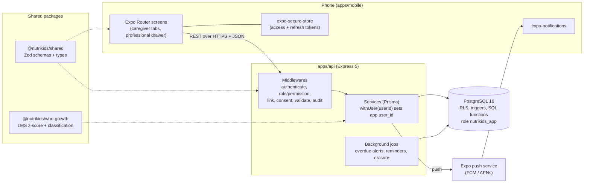
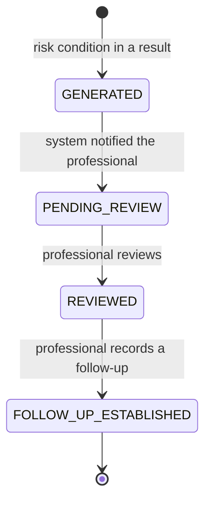
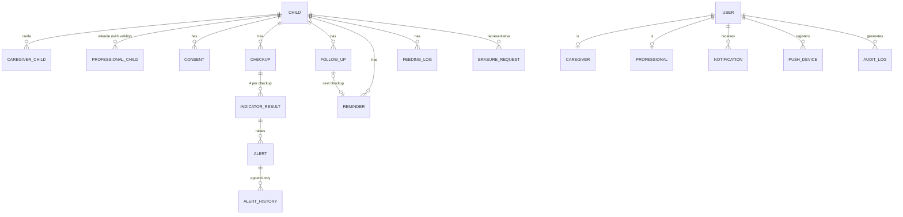

# Architecture (NK-48)

How NutriKids is built today, with diagrams (Mermaid, rendered by GitHub). Everything here describes code that exists in the repository; planned or missing pieces are listed at the end.

## 1. Components



- The phone never talks to the database. It calls the REST API with a bearer access token (15 minutes) and a rotating refresh token ([auth.md](auth.md)).
- `@nutrikids/shared` is the contract: the API validates requests with the same Zod schemas the app uses to build them.
- `@nutrikids/who-growth` is used by the API to compute the four WHO indicators (z-score, percentile, classification) when a checkup is stored. The app shows what the server computed and draws the reference curves from `GET /reference/curves`.
- Authorization is enforced twice: in Express (role, permission, link, consent) and in PostgreSQL (Row Level Security through `app_user_id()`), so a forgotten check in a route still returns no rows ([permissions.md](permissions.md)).

## 2. One request through the stack

```mermaid
sequenceDiagram
  participant App as Mobile app
  participant API as Express
  participant DB as PostgreSQL (nutrikids_app)
  App->>API: POST /children/:id/checkups (Bearer token)
  API->>API: authenticate -> checkup:create -> requireLink -> requireActiveConsent -> validate
  API->>DB: BEGIN; set_config('app.user_id', userId, true)
  API->>DB: INSERT checkup (RLS: app_has_child_access)
  API->>API: compute 4 indicators (who-growth), classify, create alerts
  API->>DB: INSERT indicator_results, alerts, alert_history; COMMIT
  API-->>App: 201 checkup (caregivers get no z-scores)
  API--)DB: audit_logs (after the response)
  API--)App: push to the assigned professionals (notifyNewAlerts)
```

## 3. Alert states



Every transition appends a row to `alert_history`. Alerts never close by themselves; past the deadline the professional is notified again ([alerts.md](alerts.md)).

## 4. Data model by area



22 tables: the 19 of the specification plus `refresh_tokens`, `push_devices` and `erasure_requests`. Names and equivalences with the report are in the README. Immutable tables (`checkups`, `alert_history`, `audit_logs`) reject `UPDATE` and `DELETE` by trigger and by revoked privileges; see the README section on immutability and RLS.

## 5. Offline checkups

The server side of the offline design exists: `POST /sync/checkups` accepts a batch of checkups captured on the device with client-generated UUIDs, inserts them idempotently, recomputes every result and audits discrepancies ([sync.md](sync.md)). The mobile app does not have a local queue yet; its checkup screens call the online endpoints.

## 6. Not implemented yet (so you do not look for it)

- Local storage and sync queue in the app (offline capture).
- Application-level encryption of columns and pseudonymised exports (RT-07 in the report). Today the protection is RLS, hashed passwords (Argon2id) and encrypted backups ([backups.md](backups.md)).
- Two-factor authentication for professionals: the schema has the columns and the login screen has the prompt, but the API always answers `requiresTwoFactor: false`.
- Caregiver push registration (the app registers tokens only for professionals).
